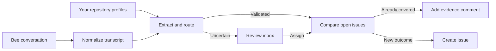
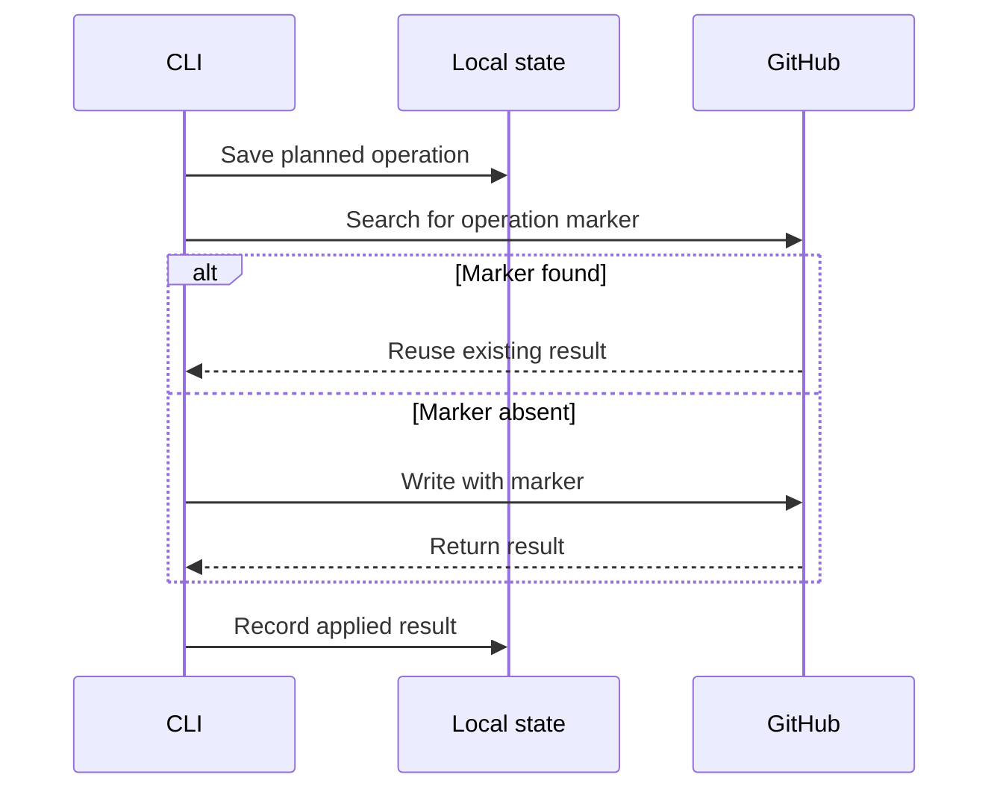

# Waggle

Waggle hears a spoken software request in a Bee conversation and points that request at a GitHub repository.

**Demo video:** not uploaded. The official rules require a video under three minutes, in English, publicly visible on YouTube or Vimeo. Put that URL here and on the Devpost form. Judges are not required to watch past three minutes.

Submission deadline: Friday, October 23, 2026, 12:00 pm Pacific (2:00 pm Central). Primary track: Bee (Wearable AI). Use cases: developer experience and personal productivity. Mini challenges are not selected.

[Problem](#problem-and-solution) · [Features](#features) · [Stack](#built-with) · [Architecture](#architecture) · [Setup](#setup) · [Testing](#testing-it) · [Demo script](docs/demo.md) · [Devpost draft](docs/devpost-submission.md)

## Problem and solution

Useful software work is often spoken before anyone opens GitHub. Bee keeps the conversation. Someone still has to rewrite the request, pick a repository, and check whether the issue already exists.

Waggle is a local TypeScript CLI that reads a Bee transcript, asks Claude for concrete software work, checks every model field, and then creates an issue, adds evidence to an open issue, or leaves the item in a local inbox.

## Features

- Reads a completed Bee conversation through the local Bee proxy, or a saved fixture.
- Builds a local map of your GitHub repositories, with pins, exclusions, and phrase aliases.
- Keeps source quotes verbatim and rejects a quote that is not copied from a single utterance.
- Compares a validated request with open issues before it writes. A repeat becomes evidence on the existing issue.
- Sends unknown, low-confidence, and malformed results to `~/.waggle/inbox.json` instead of guessing a repository.
- Blocks GitHub writes in `--dry-run`, and reconciles a live write with an invisible operation marker if the response is lost.

These captures are from real command output:


A result GIF is not included. The live Bee runs below are the working demonstration.

## Built with

The Bee track requires the code to call Bee at runtime and the video to show that Bee data doing something useful. Waggle does that through the Bee CLI proxy: `GET /v1/conversations`, `GET /v1/conversations/:id`, and the SSE stream in `src/bee.ts`.

| Tool | Role |
| --- | --- |
| Bee CLI proxy and conversation API | Source transcripts from a Bee device or an Apple Watch running Bee |
| Anthropic Claude API | Repository profiles, ticket extraction, and duplicate classification |
| GitHub REST API through Octokit | Repository discovery, open-issue reads, issues, and evidence comments |
| TypeScript and Node.js 20 | The local CLI |

AWS Builder is not selected. The code does not call an AWS service.

The Open Source mini challenge is not selected. That challenge asks for an additional public contribution alongside the primary-track project, with its own URL and description. Publishing this repository is the primary submission.

## Architecture



Repository names are not compiled into the source. Waggle discovers repositories you own or collaborate on, skips archived repositories, includes repositories pushed in the last 12 months, and lets you pin older ones. Claude turns bounded metadata and a README excerpt into a local profile. An alias such as “the robot” overrides that inference.

A candidate continues only after the CLI checks repository membership, field bounds, enums, confidence, the requester’s speaker name, and quote provenance. Dedupe asks one question: if the open issue were finished, would this request also be done?



The marker covers a lost HTTP response. It is not a claim of universal exactly-once delivery.

## Setup

### Prerequisites

- Node.js 20
- A Bee device, or an Apple Watch running Bee, plus Bee CLI access
- An Anthropic API key
- A fine-grained GitHub personal access token for the account that owns the target repositories

For live issue creation the token needs Contents: Read, Issues: Read and write, and Metadata: Read. A token without Issues write can read the repository and still receive `403 Resource not accessible by personal access token` on issue creation. That happened on October 23, 2026, and a replacement token with Issues write succeeded.

### Install

```bash
npm install
cp .env.example .env
```

Fill `.env` from the comments in `.env.example`. Never commit `.env`.

- `ANTHROPIC_API_KEY` — profiles, extraction, and dedupe
- `GITHUB_TOKEN` — repository and issue access
- `BEE_API_BASE` — local Bee proxy, default `http://127.0.0.1:8787`
- `BEE_TOKEN` — only for the direct Bee API
- `DEV_NAME` — your speaker name in Bee transcripts
- `CLAUDE_MODEL` — optional model override
- `WAGGLE_HOME` — optional state directory, default `~/.waggle`

Start the proxy in another terminal:

```bash
npm install -g @beeai/cli
bee login
bee proxy
```

### Repository policy

`~/.waggle/config.json`:

```json
{
  "version": 1,
  "pinnedRepos": ["owner/quiet-but-active-project"],
  "excludedRepos": ["owner/private-scratchpad"],
  "aliases": {
    "the robot": "owner/delivery-robot"
  },
  "routingConfidence": 0.6
}
```

A repository cannot be both pinned and excluded. An alias cannot point at an excluded, archived, or missing repository.

```bash
npm start -- repos refresh
npm start -- repos
```

`repos refresh` calls GitHub and Claude. Read the cached list before you process a conversation.

## Testing it

There is no web login. The repeatable path is a fixture, and it still calls Claude:

```bash
GITHUB_TOKEN= npm start -- fixture fixtures/robotics-team.json --dry-run --verbose
```

Clearing `GITHUB_TOKEN` keeps the preview off fictional repository names. That run does not prove live dedupe. The fixture files state the expected tickets. Those expectations are contracts. A live-model test of them is skipped when `ANTHROPIC_API_KEY` is absent, and those two tests were skipped in the October 23 run below.

The live path needs the proxy and a fine-grained token with Issues write. On October 23, 2026, two completed Bee conversations were processed against `fortakenjay/splitit`:

```bash
npm start -- conv 11575767 --verbose
npm start -- conv 11576634 --verbose
```

The first created [issue 1](https://github.com/FortakenJay/SplitIt/issues/1), [issue 2](https://github.com/FortakenJay/SplitIt/issues/2), [issue 3](https://github.com/FortakenJay/SplitIt/issues/3), and [issue 4](https://github.com/FortakenJay/SplitIt/issues/4). The second created [issue 5](https://github.com/FortakenJay/SplitIt/issues/5) and [issue 6](https://github.com/FortakenJay/SplitIt/issues/6). Four other requests from the second conversation went to the local inbox because a quote was not a verbatim copy of one utterance. Both conversation IDs are now marked processed, so a later run skips them unless you pass `--force`.

`--dry-run` blocks label, issue, and comment writes. It can still read Bee, call Claude, read GitHub, refresh profiles, update the inbox, and store planned operations. Without `GITHUB_TOKEN`, the CLI enters dry-run by itself.

## Challenges and what we learned

These are observations from building and from the October 23 runs. Product-feedback answers for Devpost are still blank in [docs/product-feedback.md](docs/product-feedback.md) and have to be filled from direct use before submission.

- GitHub issue creation has no idempotency key. Waggle stores the operation first and looks for its marker before it writes again.
- Claude’s tool output is checked at runtime. A plausible title is not enough: the requester must be a transcript speaker, and every quote must be one utterance or a contiguous excerpt of one utterance.
- A request spoken across several lines can fail that quote check. On conversation `11576634`, four requests landed in the inbox with a title and a reason, and no assignable ticket. How those quotes should be kept is still an open decision.
- A fine-grained token can show repository admin on a GET and still be forbidden to create issues.
- Bee can emit the same completion more than once. A processed conversation is skipped, and an applied operation is not created twice.

## What's next

Record the public demo video from [docs/demo.md](docs/demo.md), using a real Bee conversation and one of the GitHub results above. Fill product feedback for Bee, Claude, GitHub, and the Bee CLI. Decide the multi-utterance quote rule before treating the four inbox titles as finished work.

The [roadmap](docs/roadmap.md) keeps later product measures open. It does not add AWS, a hosted service, or a new track.

## Team and license

Jih Bin Luo and Justin Meng. The repository is public at https://github.com/FortakenJay/Waggle. The license is MIT, copyright 2026 Jih Bin Luo and Justin Meng. GitHub’s license API reported SPDX `MIT` for the root `LICENSE` file.

## Command reference

```text
waggle repos
waggle repos refresh

waggle fixture <file.json> [flags]
waggle conv <conversation-id> [flags]
waggle latest [count] [flags]
waggle watch [flags]

waggle inbox
waggle inbox assign <n> <owner/repo> [flags]
waggle inbox drop <n>
```

From this checkout, prefix arguments with `npm start --`:

```bash
npm start -- latest 3 --dry-run
npm start -- conv <conversation-id> --dry-run --verbose
npm start -- watch --dry-run
npm start -- inbox
npm start -- inbox assign <n> owner/repo --dry-run --verbose
npm start -- inbox drop <n>
```

- `--dry-run` blocks GitHub mutations
- `--verbose` prints the full issue preview, including quotes
- `--force` extracts a processed conversation again, and does not recreate an operation that is already applied
- `--min-confidence <0..1>` overrides the extraction threshold
- `--debug` prints one raw Bee payload

An inbox number comes from the current `inbox` list. Assignment still runs dedupe and the write guard. An inbox row with no validated ticket cannot be assigned.

Local files, under `~/.waggle` unless `WAGGLE_HOME` is set:

- `config.json` — pins, exclusions, aliases, routing threshold
- `repos.json` — generated profiles
- `inbox.json` — work waiting for a decision
- `state.json` — processed conversations and operations

Updates use a temporary-file rename and a short single-writer lock. Inspect these files before you share them. They can contain repository names and conversation text.

## Verification

Run on October 23, 2026, in this checkout:

```bash
npm run typecheck  # passed
npm test           # 9 passed, 2 live-Claude tests skipped
```

`npm start -- --help` and `npm start -- inbox --dry-run` were run earlier, and the images above were generated from that output. The two skipped tests are the live Claude fixture contracts. Both live `conv` commands in [Testing it](#testing-it) exited 0 and created the linked issues.

The [project log](docs/project-log.md) records the product decisions. The [safety model](docs/safety.md) is the full dry-run and recovery description.
