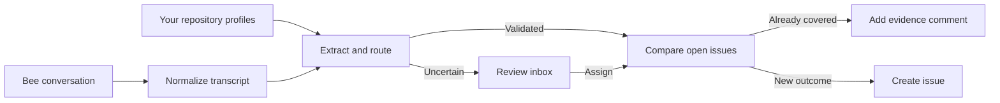
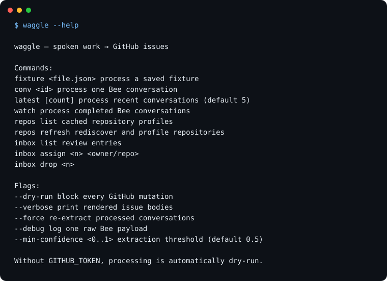
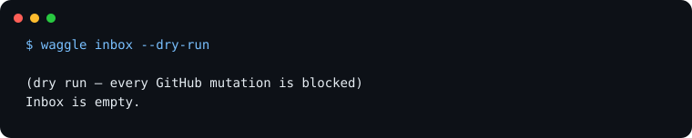
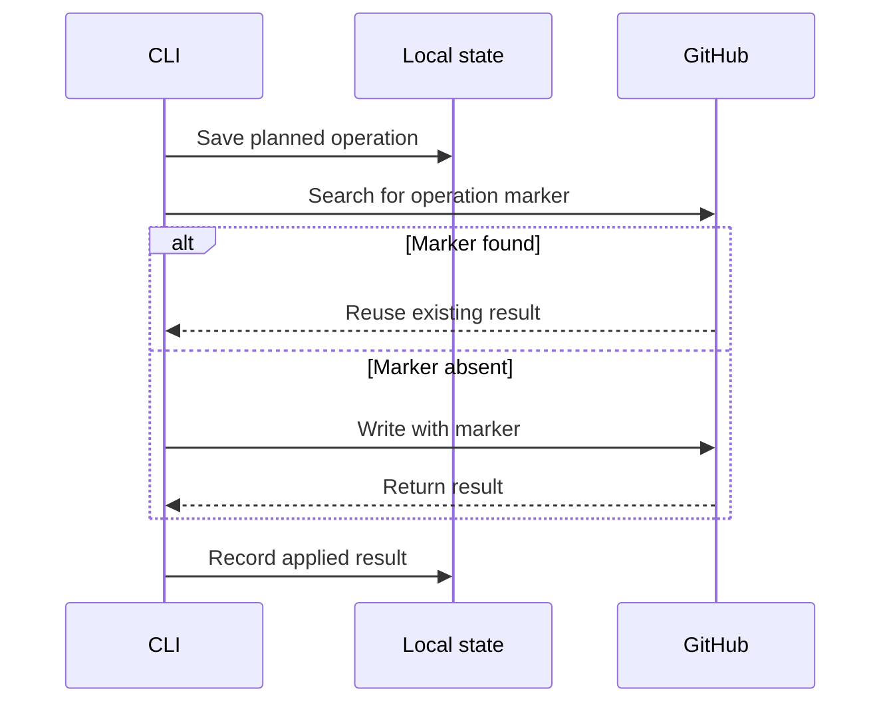

# Waggle

Bees do a waggle dance to tell the hive where to go. I named this tool Waggle because it does that job for software work: it hears a spoken request and points the request at a repository.

The useful issue is often spoken before it is written.

A teammate notices that Safari breaks the login page. A classmate asks for CSV export. A developer says, “remind me to fix that flaky test,” while their hands are nowhere near GitHub. Bee can preserve those conversations, but someone still has to remember the work, rewrite it, choose a repository, and check whether the issue already exists.

Waggle is a local TypeScript CLI that closes that gap. It reads Bee conversations, asks Claude for structured software work, routes each candidate against profiles of your GitHub repositories, and turns the result into one of three honest outcomes:

- a new issue;
- an evidence comment on an open issue that already covers the request; or
- an inbox item that waits for a human routing decision.

The source words stay attached. The uncertainty stays visible. GitHub writes stay behind an explicit safety boundary.

> Submission context: this project is being prepared for Devpost's Build, Ship, Shape Amazon Developer Hackathon, with Bee as the primary track and developer experience plus personal productivity as the relevant use cases. Local checks pass; live Bee, Claude, and GitHub evidence is still in progress.

[Setup](#setup) · [Commands](#command-reference) · [Safety](#what-dry-run-means) · [Demo](docs/demo.md) · [Project wiki](docs/README.md) · [Devpost checklist](docs/devpost-submission.md)

## From a conversation to a useful issue



The repository map is not compiled into the source. Waggle discovers repositories you own or collaborate on, excludes archived work, includes recently pushed repositories, and lets you pin older projects. Claude condenses bounded repository metadata into local routing profiles. Your aliases—phrases such as “the robot”—override inference.

Extraction is structured but not trusted. The CLI checks repository membership, field bounds, enums, confidence, requester identity, and exact quote provenance before a candidate can continue. Low-confidence and malformed candidates go to review instead of becoming plausible-looking GitHub noise.

Dedupe asks a strict question: **if the open issue were completed, would this request also be satisfied?** Related work is not enough. A true repeat becomes evidence on the existing issue.

This terminal capture is generated from the real `--help` output, not a designed mock:



## Why Bee

Bee supplies the data that ordinary issue forms miss: the request as it was said, the surrounding conversation, and the moment the conversation completed. Waggle uses the local Bee proxy or direct Bee API, not a copied summary pasted into another tool. The live `watch` path listens for completion or summary events, fetches the complete conversation, and sends it through the same reviewed pipeline as a saved fixture.

This is different from treating every transcript line as a todo. Software work can come from a client, teammate, classmate, professor, or the developer speaking to themself. Scheduling, billing, small talk, and unsupported ideas are not repository work by default.

## Setup

### Prerequisites

- Node.js 20
- A Bee device, or an Apple Watch running Bee, for the live path
- Bee CLI access for `bee proxy`, or a direct Bee API token
- An Anthropic API key
- A fine-grained GitHub token scoped to the repositories you intend to read or change

The GitHub operations in this project read repository metadata, README excerpts, and open issues; live mode can create labels, issues, and comments. Grant only the repository access and permissions those calls need.

### Install and configure

```bash
npm install
cp .env.example .env
```

Fill in `.env` using the comments in `.env.example`. Never commit it. The relevant settings are:

- `ANTHROPIC_API_KEY` — repository profiles, extraction, and dedupe
- `GITHUB_TOKEN` — repository and issue reads; required for GitHub writes
- `BEE_API_BASE` — defaults to the local Bee proxy
- `BEE_TOKEN` — only for direct Bee API access
- `DEV_NAME` — your speaker name in Bee transcripts
- `CLAUDE_MODEL` — optional model override
- `WAGGLE_HOME` — optional local-state directory override

Start the Bee proxy in another terminal for real conversations:

```bash
npm install -g @beeai/cli
bee login
bee proxy
```

### Configure repository policy

Waggle stores local files under `~/.waggle/` by default. Its config schema is:

```json
{
  "version": 1,
  "pinnedRepos": ["owner/quiet-but-active-project"],
  "excludedRepos": ["owner/private-scratchpad"],
  "aliases": {
    "the robot": "owner/delivery-robot"
  },
  "routingConfidence": 0.6
}
```

- `pinnedRepos` includes a repository even when its last push is older than 12 months.
- `excludedRepos` removes a repository from routing.
- `aliases` maps your language to one repository and beats inferred routing.
- `routingConfidence` must be between `0` and `1`.

A repository cannot be both pinned and excluded. An alias cannot target an excluded, archived, or unavailable repository.

Build the first profile cache:

```bash
npm start -- repos refresh
npm start -- repos
```

Profile refresh calls both GitHub and Claude. Review the resulting repository list before processing a conversation.

## Start with a preview

The fixture path does not need Bee, but it still uses the same extraction, routing, dedupe, and write rules:

```bash
npm start -- fixture fixtures/robotics-team.json --dry-run --verbose
```

Keep `--dry-run` in rehearsal commands. A fixture is not permanently sandboxed; with a GitHub token and no dry-run flag, it can create real work.

The bundled fixture repository names are fictional. When `.env` contains a GitHub token, clear it for these fixture previews so the CLI does not try to read issues from those names:

```bash
GITHUB_TOKEN= npm start -- fixture fixtures/robotics-team.json --dry-run --verbose
```

That run cannot exercise live GitHub dedupe; it exercises extraction, routing, review, rendering, and the write guard.

The fixture files declare contracts, not successful run results:

- `robotics-team.json` expects three accepted requests in `example-labs/delivery-robot` and one review item. The repeated reconnect problem should merge with both quotes; CSV route export and battery temperature should split.
- `solo-mixed.json` expects three accepted requests—two in `sample-dev/study-planner`, one in `sample-dev/portfolio-web`—and one review item. The flaky test and calendar export should split, while the Spanish timezone requirement should support the calendar ticket.

Live-model tests assert those contracts when `ANTHROPIC_API_KEY` is available. They have not been reported as passing here.

## Command reference

The final command surface is:

```text
waggle repos
waggle repos refresh

waggle fixture <file.json> [flags]
waggle conv <conversation-id> [flags]
waggle latest [count] [flags]
waggle watch [flags]

waggle inbox
waggle inbox assign <n> <owner/repo> [flags]
waggle inbox drop <n>
```

During local development, use `npm start --` before the arguments:

```bash
npm start -- latest 3 --dry-run
npm start -- conv <conversation-id> --dry-run --verbose
npm start -- watch --dry-run
```

Relevant flags:

- `--dry-run` — block GitHub mutations
- `--verbose` — print complete issue previews, including source quotes
- `--force` — repeat extraction for a processed conversation without bypassing applied operation IDs
- `--min-confidence <0..1>` — override the extraction threshold
- `--debug` — print one raw Bee payload for shape diagnosis

`npm start -- help` was run successfully against this command surface. Processing commands still require separate verification.

## The review inbox

Unknown is a valid result. List local review items:

```bash
npm start -- inbox
```

The list displays a number for each current item. Assign a validated candidate to a repository already present in the cache:

```bash
npm start -- inbox assign <n> owner/repo --dry-run --verbose
```

Or deliberately remove it:

```bash
npm start -- inbox drop <n>
```

Manual assignment does not skip dedupe or write safety.

The empty state is also explicit:



## What dry-run means

Dry-run means **no GitHub mutations**. It blocks label creation, issue creation, and evidence comments at the GitHub boundary.

It may still:

- read Bee conversations;
- call Claude;
- read repositories and open issues;
- refresh `~/.waggle/repos.json`;
- add or update `~/.waggle/inbox.json`;
- save planned, unapplied operations in `~/.waggle/state.json`;
- print transcript-derived source quotes.

Live GitHub writes require both `GITHUB_TOKEN` and the absence of `--dry-run`. Read [the complete safety model](docs/safety.md) before the first live command.

Without `GITHUB_TOKEN`, the CLI automatically enters dry-run. GitHub reads are then unavailable, so a fixture preview cannot prove that dedupe found no existing issue.

## Retry safety

A network timeout can happen after GitHub accepts a write but before the CLI receives the response. Waggle addresses that narrow ambiguity with a persisted operation ledger and an invisible marker:



This is a concrete retry mechanism, not a claim of universal exactly-once delivery.

## Local files

By default:

- `~/.waggle/config.json` — pins, exclusions, aliases, and routing threshold
- `~/.waggle/repos.json` — generated repository profiles
- `~/.waggle/inbox.json` — work waiting for review
- `~/.waggle/state.json` — processed conversations and GitHub operations

Updates use temporary-file rename and a short-lived single-writer lock. These files can contain repository and conversation context; inspect them before sharing.

## Verification status

The local implementation checks completed on October 22, 2026, and were run again after the command was renamed to `waggle`:

```bash
npm run typecheck  # passed
npm test           # 8 passed, 2 live-Claude tests skipped
npm start -- --help
npm start -- inbox --dry-run
```

The help and empty-inbox images in this README were regenerated from that second run.

The source scan found no legacy product names under `src/`. Both required fixture commands reached extraction, then stopped because `ANTHROPIC_API_KEY` is unavailable in this environment. Their expected tickets are therefore contracts, not claimed live-model results.

Before submission, run both fixture previews with an Anthropic key, refresh real repository profiles, and record one safe live Bee-to-GitHub result.

## Demo and project record

The [four-step demo](docs/demo.md) covers repository profiles, fixture preview, the review inbox, and the live Bee loop. It also includes an under-three-minute video outline.

The [project log](docs/project-log.md) records every established choice with its reason, alternatives, consequences, and verification status. The [documentation index](docs/README.md) links the product brief, architecture, roadmap, submission material, feedback, friction log, and screenshot plan.

## Repository access

The chosen path is a public GitHub repository with an open-source license file visible on the repository page. The license itself is still unselected, so that file is not in the tree yet. The project does not claim the Open Source mini challenge.
