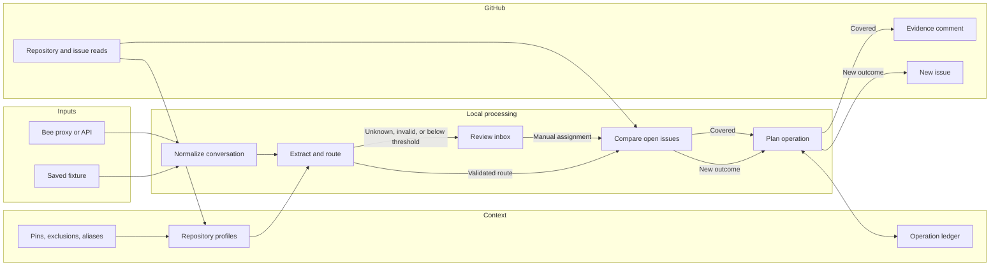
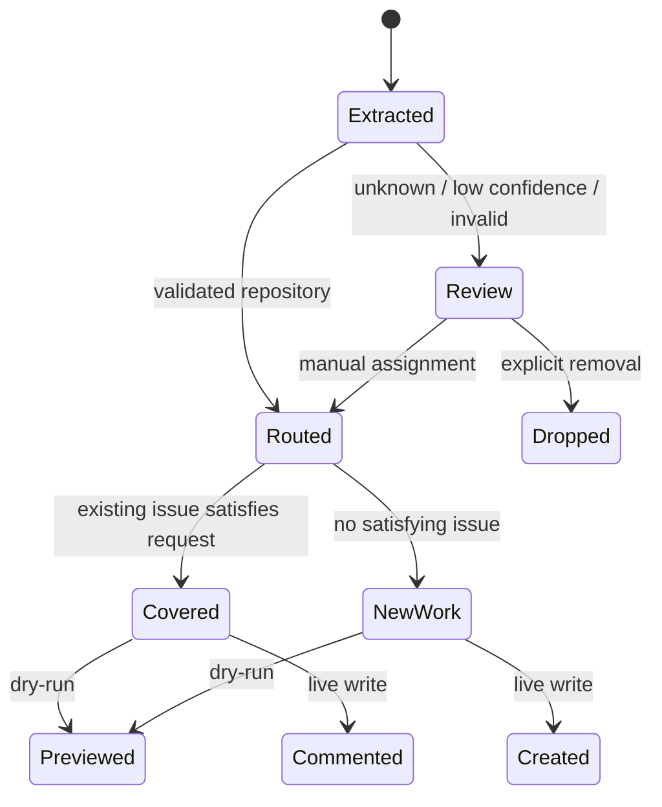
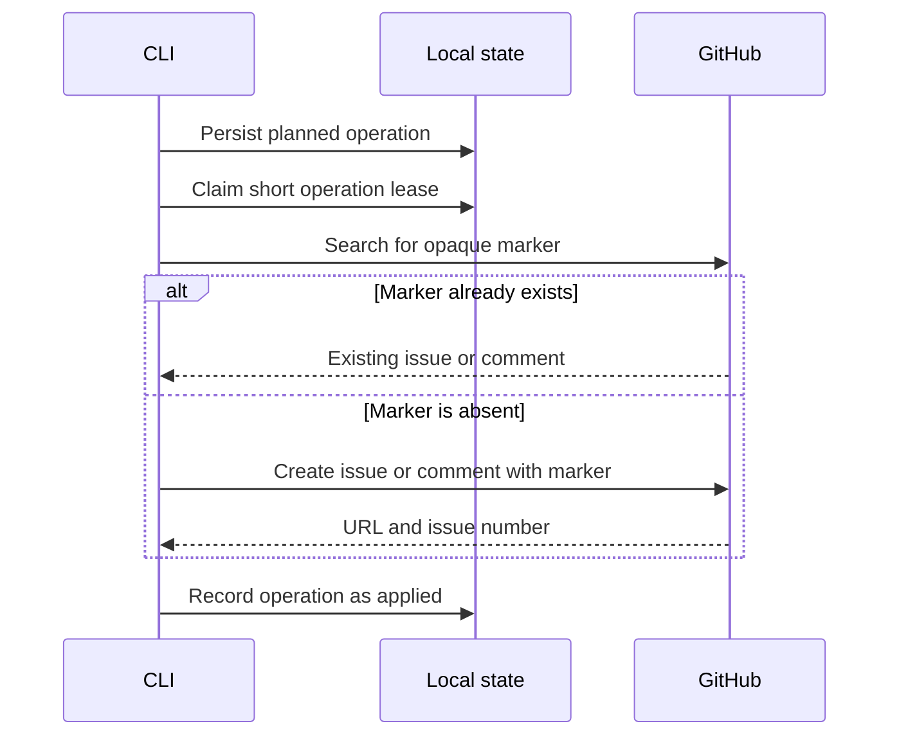
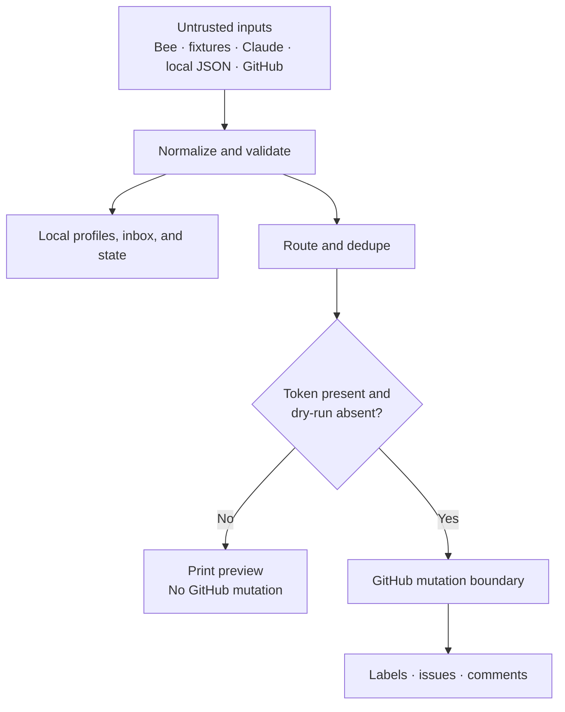

# How a conversation becomes an issue

A spoken request is messy by nature. It can be repeated, mixed across languages, or mentioned beside unrelated plans. Waggle treats that mess as input, not as permission to write immediately.

The target architecture narrows uncertainty in stages. The supporting modules exist, while final command integration and end-to-end verification are still in progress.

## Repository discovery

A refresh asks GitHub for repositories the token can see through owner or collaborator affiliation. Archived repositories are unavailable. Repositories pushed within the previous 12 months are eligible by default; a pin includes an older repository without changing the archived rule.

For each eligible repository, Claude condenses the name, description, topics, primary language, and up to the opening 1,500 README characters into a small routing profile. The profile is cached under `~/.waggle/repos.json` by default.

Configuration is policy, not a suggestion:

- exclusions remove repositories;
- pins restore inactive repositories;
- contradictory pins and exclusions are errors;
- aliases deterministically route matching language;
- conflicting alias matches fail instead of choosing one.

## Extraction and review

Claude must return candidates through a structured tool call. The application then validates the value at runtime:

- the repository is `unknown` or exists in the current cache;
- kind, priority, confidence, and routing confidence are valid;
- title, problem, criteria, requester, and quote bounds hold;
- the requester is a transcript speaker;
- every quote exactly matches a normalized utterance;
- any alias override still points to an available repository.

Low-confidence, unknown, and malformed results take the review path. Validated inbox items can be assigned only to a cached repository, after which they rejoin the normal dedupe and write flow.

## Dedupe means “already satisfied”

Two issues can be related without being duplicates. The dedupe rule is stricter:

> If the existing issue were completed, would this candidate also be satisfied?

Open issues are paginated and sent to Claude in bounded batches. Every returned issue number must come from its batch. Missing, malformed, incomplete, or conflicting decisions stop safely; they never become “create a new issue” by default.

A covered request becomes an evidence comment. The comment preserves the new source instead of creating a second issue.

## Recovering from an ambiguous write

GitHub can accept a write even when the response never reaches the CLI. Saving only after success can therefore duplicate work on retry.

Waggle plans each external action first and gives it an opaque operation marker. The marker is included as an invisible HTML comment.

This is a recovery mechanism for a specific ambiguous failure, not a universal exactly-once guarantee.

## Trust boundaries

Bee payloads, saved fixtures, Claude output, local JSON, GitHub responses, and human configuration all cross a validation boundary. GitHub mutations cross an additional dry-run boundary.

## Module boundaries

- `src/bee.ts` — Bee REST, normalization, debug payload, and SSE
- `src/repos.ts` — config, discovery, generated profiles, and routing context
- `src/extract.ts` — candidate extraction and runtime validation
- `src/dedupe.ts` — open-issue classification and validation
- `src/inbox.ts` — local review queue
- `src/state.ts` — paths, atomic persistence, locks, and operation ledger
- `src/github.ts` — GitHub reads, rendering, labels, writes, and marker lookup
- `src/index.ts` — command parsing and orchestration

The intended dependency direction is orchestration toward focused modules; no module other than `github.ts` should mutate GitHub.
